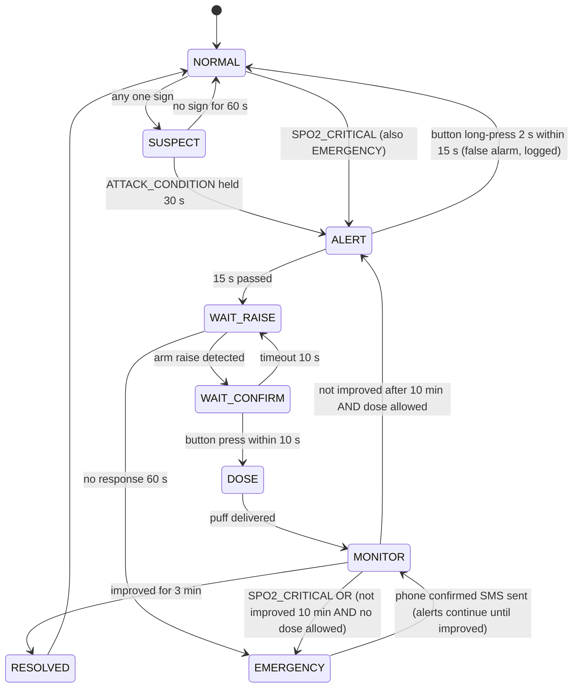

# AsthmaGuard — Project Plan & Build Spec

> A wrist-worn device that detects a likely asthma attack (cough sounds + heart rate + SpO2), alerts the patient, delivers one inhaler puff after the patient raises their arm and confirms, and escalates to family by SMS + GPS through a paired phone app. A Flutter app records every episode so the doctor can review it on the patient's phone.
>
> This file is the single source of truth for building the project with Claude Code. Build phase by phase (section 9). Do not skip the simulation mode: it is how the system gets tested without a real attack.

---

## 1. Fixed decisions

| Topic | Decision |
|---|---|
| Patients | Adults, 18+ |
| Board | Raspberry Pi Pico 2 W (RP2350 + on-board Wi-Fi/BLE) |
| Firmware | C++ on the Arduino-Pico core (earlephilhower), built with PlatformIO |
| Wear position | Wrist |
| Sound | Cough detection only (TinyML model via Edge Impulse). Wheeze = future work (chest sensor) |
| Phone link | BLE (on-board radio, no external Bluetooth module) |
| Emergency message | Sent by the phone (SMS + GPS link) to family contacts. No GPS module on the device |
| App | Flutter. Doctor reviews data on the patient's phone (PIN-protected doctor area + PDF export) |
| Dosing | Never automatic on arm-raise alone. Arm-raise + button confirm. Dose limits set by the doctor in the app; dosing disabled until they are set |

Assumed parts (swap the driver file if the team's parts differ): INMP441 mic, MPU6050 IMU.

---

## 2. System overview

```
[MAX30102] [MPU6050] [INMP441] [Button]
      \        |         /        /
       +--- Pico 2 W (detector + state machine) ---+
       |            |              |               |
  [Vibration]   [Buzzer]   [Servo -> MDI inhaler]  BLE
                                                    |
                                     Flutter app (phone)
                      live view · history · doctor area · PDF
                      SMS + GPS to family · "Call 123" button
```

---

## 3. Hardware

### 3.1 Bill of materials

| Part | Role | Notes |
|---|---|---|
| Raspberry Pi Pico 2 W | MCU + BLE | |
| MAX30102 module | Heart rate + SpO2 | I2C addr 0x57. Strap must be snug on the wrist underside |
| MPU6050 module | Activity level + arm-raise detection | I2C addr 0x68 (shares the bus with MAX30102) |
| INMP441 | I2S microphone, 16 kHz | Mic hole facing up/out of the enclosure |
| SG90 micro servo (or MG90S) | Presses the inhaler canister | Needs 5 V |
| Pressurized MDI inhaler | Medicine | Mounted so the mouthpiece faces the mouth when the arm is raised |
| Coin vibration motor + 2N2222 + 1N4148 diode + 1 kΩ | Haptic alert | Never drive the motor straight from a GPIO |
| Active piezo buzzer + 2N2222 + 1 kΩ | Audible alert | |
| Push button | Confirm / cancel / SOS | |
| 3.7 V LiPo (≥ 1000 mAh) | Power | |
| TP4056 charger **with protection** | Charging | |
| MT3608 boost → 5 V | Servo supply | |
| 100–470 µF capacitor | On the 5 V rail near the servo | Stops resets when the servo moves |

### 3.2 Pin map (Pico 2 W)

| Signal | Pin |
|---|---|
| I2C0 SDA (MAX30102 + MPU6050) | GP4 |
| I2C0 SCL | GP5 |
| I2S BCLK (INMP441 SCK) | GP10 |
| I2S LRCLK/WS (INMP441 WS) | GP11 (must be BCLK + 1 for the Arduino-Pico I2S class) |
| I2S DATA (INMP441 SD) | GP12 |
| INMP441 L/R | GND (left channel) |
| Buzzer (via transistor) | GP13 |
| Vibration motor (via transistor) | GP14 |
| Servo signal | GP15 |
| Button (other leg to GND, INPUT_PULLUP) | GP16 |

Power: LiPo → TP4056 OUT → Pico VSYS (and → MT3608 → 5 V → servo only). All grounds common. Sensors run from the Pico 3V3(OUT).

Battery level: read VSYS as the Arduino-Pico docs describe for W boards (on Pico W/2 W the VSYS ADC pin is shared with the wireless chip).

---

## 4. Detection logic

All numbers below are **defaults stored in config** and editable from the doctor area of the app.

### 4.1 Signals (updated every second)

- `hr` and `spo2` from MAX30102, with `ppg_valid` = true only if the IMU says the wrist was still for the last 5 s **and** the signal-quality check passes. Invalid readings are never used for decisions.
- `cough_60s` = number of cough events in the last 60 s (model score ≥ 0.80, events at least 300 ms apart).
- `activity` = IMU motion level over the last 60 s: `REST`, `LIGHT`, `EXERCISE`.
- `baseline_hr`, `baseline_spo2` = the patient's resting values from the calibration period (section 6.4). Until calibration finishes use HR 75, SpO2 97.

### 4.2 Rules

| Name | Condition |
|---|---|
| `COUGH_SIGN` | `cough_60s ≥ 4` |
| `HR_SIGN` | valid `hr ≥ baseline_hr + 20` **or** `hr ≥ 110` |
| `SPO2_SIGN` | valid `spo2 ≤ 94` |
| `SPO2_CRITICAL` | valid `spo2 < 92` for 20 s in a row |
| `NOT_EXERCISE` | `activity != EXERCISE` |
| `ATTACK_CONDITION` | `COUGH_SIGN && (HR_SIGN || SPO2_SIGN) && NOT_EXERCISE` |

- `SUSPECT` when any one sign is present.
- `ATTACK` when `ATTACK_CONDITION` holds for 30 s in a row.
- `SPO2_CRITICAL` at any time → attack alert **and** emergency escalation.

### 4.3 State machine



Notes:
- **Anywhere:** button long-press 5 s = manual SOS → `EMERGENCY`.
- **ALERT output:** vibration pattern 500 ms on / 500 ms off plus buzzer beeps, repeated.
- **Arm raise (IMU):** wrist pitch changes ≥ 60° within 1.5 s and stays there ≥ 1 s. Tune with real recordings.
- **DOSE:** allowed only if doctor limits are set, `doses_this_episode < max_doses_per_episode` and `now - last_dose ≥ min_dose_interval`. Servo goes to `press_angle`, holds 500 ms, returns to `rest_angle`. Every puff is logged.
- **Improved:** valid SpO2 ≥ 94, HR ≤ baseline + 10, and `cough_60s ≤ 1`, all for 3 minutes.
- **EMERGENCY:** device sends an emergency event over BLE. If the phone is not connected, it keeps alerting and retries every 10 s. Log the failure.

---

## 5. Firmware

### 5.1 Layout

```
firmware/
  platformio.ini
  src/
    main.cpp            setup, core split, main loop
    config.h/.cpp       defaults + load/save (LittleFS)
    sensors/ppg.*       MAX30102 driver, HR/SpO2, quality flag
    sensors/imu.*       MPU6050, activity level, arm-raise detector
    sensors/audio.*     I2S capture 16 kHz, continuous inference, cough events
    sensors/features.*  log-mel features (must match ml/ Python exactly)
    detector.*          signals + rules (section 4.2)
    state_machine.*     states + transitions (section 4.3)
    actuators.*         vibration, buzzer, servo (non-blocking patterns)
    ble.*               GATT service (section 5.3)
    eventlog.*          ring buffer of events, flushed to the phone on reconnect
    sim.*               simulation mode (section 5.4)
  lib/
    model/              model_data.cc (int8 TFLite model as a C array)
ml/                     Python training pipeline (section 7)
```

`platformio.ini` uses the community RP2040/RP2350 platform with the earlephilhower core and the Pico 2 W board. Check the current board ID in that platform's docs.

Core split: **core 1** = audio capture + inference only; **core 0** = sensors, detector, state machine, actuators, BLE. Share data through a lock-free queue or a mutex.

Libraries: SparkFun MAX3010x (with its SpO2 algorithm or a cleaner replacement), an MPU6050 library, the Arduino-Pico `I2S` class, the Arduino-Pico `Servo`, BTstack BLE (bundled with Arduino-Pico), and LittleFS.

### 5.2 Timing

- PPG at 100 Hz, HR/SpO2 window 4 s, updated every 1 s.
- IMU at 50 Hz.
- Audio 16 kHz, 1 s window, inference every 250 ms (continuous mode).
- Detector + state machine tick every 1 s. Actuators driven by a non-blocking scheduler. **No `delay()` in the main loop.**

### 5.3 BLE protocol

One custom service. Payloads are short JSON strings (negotiate MTU ≥ 185).

| Characteristic | Props | Content |
|---|---|---|
| `live` | notify, 1 Hz | `{"hr":88,"spo2":97,"v":1,"c60":0,"act":"REST","st":"NORMAL","bat":82}` |
| `event` | notify + indicate | `{"id":123,"t":1732460000,"type":"ATTACK_START","data":{...}}`. Types: `SUSPECT`, `ATTACK_START`, `FALSE_ALARM`, `ARM_RAISED`, `DOSE`, `IMPROVED`, `EMERGENCY`, `MANUAL_SOS`, `RESOLVED`, `LOW_BATTERY` |
| `config` | read/write | thresholds, baselines, dose limits, servo angles |
| `time` | write | epoch seconds. The phone sends it on every connect (the Pico has no battery-backed clock) |
| `cmd` | write | `TEST_ALERT`, `TEST_SERVO`, `ACK:<event id>`, `SIM:<...>` |

Events stay in `eventlog` until the phone ACKs them, so nothing is lost while disconnected.

### 5.4 Simulation mode (required)

Enabled by `cmd` `SIM:ON` or a serial command. It overrides any signal, for example `SIM:hr=125`, `SIM:spo2=91`, `SIM:cough=6`, `SIM:act=REST`, `SIM:raise`. The real state machine then runs on the fake values, so every scenario in section 8 can be demoed and tested without a real attack. The app gets a hidden "Simulation" screen with buttons for these commands.

---

## 6. Flutter app

### 6.1 Packages

`flutter_blue_plus` (BLE), `drift` or `sqflite` (local DB), `geolocator` (location), `another_telephony` or a platform channel to `SmsManager` (Android SMS), `flutter_foreground_task` (keeps the BLE link alive in the background), `fl_chart`, `pdf` + `printing`/`share_plus`, `url_launcher` (call 123 / open maps), `flutter_secure_storage` (doctor PIN). Arabic-first UI with RTL and English as a secondary language.

**Platform limit (state it in the report):** Android can send the SMS automatically. iOS does not allow silent SMS, so it opens a pre-filled message for one tap. The demo is on Android.

### 6.2 Screens

1. **Onboarding:** patient name, age (≥ 18), emergency contacts (name + phone, at least one), doctor name, permissions (Bluetooth, location, SMS, notifications).
2. **Pair device:** scan, connect, send time, read config.
3. **Home:** big status (Normal / Suspect / Attack / Emergency), live HR, SpO2 (with "measuring…" when invalid), coughs in the last minute, battery, connection state, and a "Call ambulance 123" button.
4. **History:** list of episodes: date, start/end, duration, doses, lowest SpO2, highest HR, emergency sent yes/no, false alarm yes/no.
5. **Episode detail:** HR / SpO2 / cough charts over the episode with markers for each dose and event.
6. **Doctor area (PIN):** edit thresholds, set `max_doses_per_episode` and `min_dose_interval` (dosing stays disabled until set), view baselines, export a PDF report for a date range.
7. **Settings:** contacts, test alert, test servo, re-pair, simulation screen (hidden).

### 6.3 Data model

- `patient(id, name, age, doctor_name, baseline_hr, baseline_spo2, calibrated_at)`
- `contact(id, name, phone)`
- `episode(id, start, end, state_max, doses, min_spo2, max_hr, coughs, emergency_sent, false_alarm)`
- `event(id, device_event_id, episode_id, time, type, payload_json)`
- `reading(time, hr, spo2, valid, cough_60s, activity, state)`: store every 60 s normally and every 5 s during an episode
- `dose(id, episode_id, time)`

### 6.4 Baseline calibration

For the first 3 days, the app collects valid readings taken while the IMU reports `REST`. Baseline = median HR and median SpO2. These are written to the device `config` and can be overridden in the doctor area.

### 6.5 Emergency flow (phone)

When an `EMERGENCY` or `MANUAL_SOS` event arrives:
1. Get the current GPS fix (fall back to the last known location).
2. SMS every contact:
   `تنبيه طارئ: <الاسم> بيمر بأزمة ربو ومحتاج مساعدة فورًا. الموقع: https://maps.google.com/?q=<lat>,<lng> — الأكسجين: <spo2>% النبض: <hr>`
3. Show a full-screen alert with a "Call 123" button.
4. Send `ACK` back to the device and log `emergency_sent`.

---

## 7. Cough model (built by Claude Code with the Kaggle API)

Folder: `ml/` (Python, TensorFlow/Keras). The user provides `~/.kaggle/kaggle.json`; never commit it.

1. **Data:** download cough datasets with the Kaggle API (for example COUGHVID-based sets and cough-classifier sets). For `noise`, use a general sound dataset (for example ESC-50 / UrbanSound8K): talking, laughing, sneezing, throat clearing, TV and street sound, since these are what cause false alarms. Check each dataset's license and keep a `DATASETS.md` with sources and licenses.
2. **Preprocess:** resample everything to 16 kHz mono, cut 1 s windows (cough windows centered on the cough onset; drop silent windows), balance the classes, and split train/val/test **by recording/person**, not by window, to avoid leakage. Add augmentation: background noise mixing, gain changes, small time shifts.
3. **Features:** log-mel spectrogram (or MFCC), 1 s window. **The exact same feature code must run on the Pico.** Implement it once in C++ (`firmware/src/sensors/features.*`, using CMSIS-DSP FFT) and write a Python test that feeds the same WAV files through both versions and checks that the outputs match.
4. **Model:** a small CNN (DS-CNN style), 2 classes `cough` / `noise`. Target ≥ 90% test accuracy, and report the confusion matrix and false-cough rate on noise.
5. **Export:** full int8 quantization → `.tflite` → C array (`model_data.cc`), then run it with TensorFlow Lite Micro on core 1. Model + tensor arena must fit comfortably in RAM, and inference must take well under 250 ms on the RP2350. Measure it on the board.
6. **Real-world check:** the team records a few minutes of coughs and normal noise with the INMP441 **on the wrist** and adds them to the test set (and to training if accuracy drops). This step cannot be done by Claude Code.

Fallback if the on-device features prove hard: upload the same prepared data to Edge Impulse with its CLI and export its Arduino library into `firmware/lib/ei-cough/`.

---

## 8. Test scenarios (use simulation mode + real sensors)

| # | Scenario | Expected |
|---|---|---|
| 1 | Normal rest | Stays NORMAL |
| 2 | Jogging in place (HR high, no cough) | No alert (EXERCISE) |
| 3 | Coughing only, HR/SpO2 normal | SUSPECT, no alert |
| 4 | Cough + HR 125 for 30 s | ALERT |
| 5 | Alert, then long-press within 15 s | FALSE_ALARM logged, back to NORMAL |
| 6 | Alert → raise arm → press button | One puff, MONITOR |
| 7 | Raise arm, no button | No puff |
| 8 | No response 60 s | EMERGENCY, SMS sent |
| 9 | SpO2 91 for 20 s | ALERT + EMERGENCY |
| 10 | Doses at the limit | No more puffs, EMERGENCY if not improved |
| 11 | Phone disconnected during episode | Events delivered after reconnect |
| 12 | Dose limits not set by doctor | Alerts work, servo never moves |
| 13 | 5 s long-press anytime | MANUAL_SOS |

---

## 9. Build phases for Claude Code

1. **Repo + hardware bring-up:** structure, `platformio.ini`, read each sensor over serial (HR/SpO2, IMU angles/activity, mic level), drive the buzzer, vibration motor and servo.
2. **Detector + state machine + simulation mode:** pass all scenarios in section 8 over serial using simulation mode.
3. **BLE service + event log:** test with nRF Connect before the app exists.
4. **Cough model + audio:** train the model in `ml/` (section 7), then add I2S capture + on-device features + TFLite Micro inference on core 1, then cough events into the detector.
5. **Flutter app:** pairing, live view, DB, history, episode detail.
6. **App emergency flow + doctor area + PDF + calibration.**
7. **Integration:** run every scenario end to end, tune thresholds, then measure battery life.
8. **Report material:** block diagram, state diagram, wiring diagram, results table and limitations.

---

## 10. Limitations & future work (for the report)

- Wrist SpO2 is less accurate than finger SpO2, so readings are only used when the wrist is still.
- Only cough sounds are detected. **Future:** a chest sensor (contact mic / accelerometer patch) to detect wheezing, the most specific sound of an asthma attack.
- Thresholds are general adult values plus a personal baseline. A real product would need clinical validation.
- iOS cannot send SMS automatically.
- This is a student prototype, not a certified medical device. The patient must still carry their normal inhaler.
