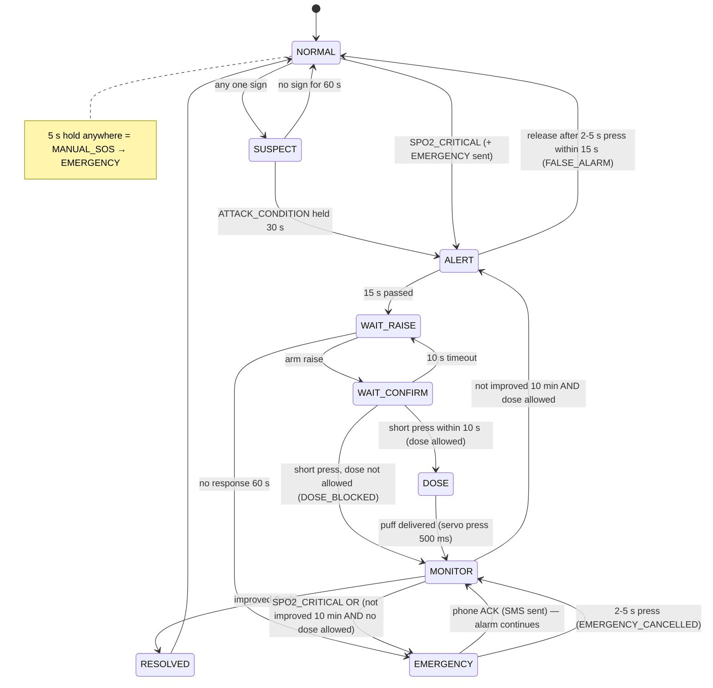

# AsthmaGuard — report material

Student prototype, not a certified medical device. The patient must still carry their normal inhaler.

## 1. Block diagram

```mermaid
flowchart LR
  subgraph Wrist["Device (Raspberry Pi Zero 2 W, asthmaguardd)"]
    MAX[MAX30102<br/>HR + SpO2<br/>I2C 0x57] --> M
    IMU[MPU6050<br/>activity + arm raise<br/>I2C 0x68] --> M
    BTN[Button<br/>GPIO17] --> M
    MIC[INMP441<br/>I2S 16 kHz, ALSA] --> A
    A["Audio thread<br/>log-mel features<br/>int8 DS-CNN (TFLM)<br/>every 250 ms"] -- cough scores<br/>queue --> M
    M["Main loop<br/>detector + state machine (1 Hz)<br/>event log, config (/var/lib/asthmaguard)"] --> VIB[Vibration motor<br/>GPIO24 via 2N2222]
    M --> BUZ[Buzzer<br/>GPIO23 via 2N2222]
    M --> SERVO[SG90 servo<br/>PWM GPIO12, 5 V] --> MDI[MDI inhaler]
    M <--> BLE((BLE GATT<br/>BlueZ))
  end
  BLE <--> APP
  subgraph Phone["Flutter app (Android)"]
    APP[Live view · history · charts<br/>doctor area (PIN) · PDF]
    APP --> SMS[SMS + GPS link<br/>to family]
    APP --> CALL[Call 123]
  end
```

## 2. State diagram (as implemented)



## 3. Wiring

| From | To | Notes |
|---|---|---|
| 5 V ≥ 2.5 A USB supply | Zero 2 W PWR IN (micro-USB) | no battery |
| 5V (pin 2) | SG90 red | + 470 µF across 5 V/GND at the servo |
| 3V3 (pin 1) | MAX30102 VIN, MPU6050 VCC, INMP441 VDD | |
| GPIO2 (pin 3) / GPIO3 (pin 5) | SDA / SCL of MAX30102 and MPU6050 | I2C1, 400 kHz |
| GPIO18 (pin 12) / GPIO19 (pin 35) / GPIO20 (pin 38) | INMP441 SCK / WS / SD | INMP441 L/R → GND |
| GPIO23 (pin 16) → 1 kΩ → 2N2222 base | buzzer − (buzzer + to 3V3) | emitter to GND |
| GPIO24 (pin 18) → 1 kΩ → 2N2222 base | motor − (motor + to 5 V), 1N4148 across the motor | never drive the motor from the GPIO |
| GPIO12 (pin 32) | SG90 signal (orange) | hardware PWM0 (`dtoverlay=pwm,pin=12,func=4`) |
| GPIO17 (pin 11) | button → GND | internal pull-up |
| all GND (pins 6, 9, 14, …) | common | |

Boot config: `device/deploy/config.txt.snippet` (I2C, I2S microphone overlay, PWM). `sudo sh device/deploy/setup.sh` installs everything.

## 4. Test results (simulation mode, the real device logic built on Linux)

`ctest --test-dir build` (after `cmake -S device -B build && cmake --build build`) runs these on the same C++ that runs on the Zero 2 W (`Core` = detector + state machine + event log + simulation).

| # | Scenario | Expected | Test | Result |
|---|---|---|---|---|
| 1 | Normal rest (10 min) | stays NORMAL | `s01_normal_rest` | pass |
| 2 | Jogging (HR 150, EXERCISE), also with coughs | no alert | `s02_jogging_no_alert` | pass |
| 3 | Coughing only | SUSPECT, no alert; NORMAL 60 s after | `s03_cough_only_suspect` | pass |
| 4 | Cough + HR 125 for 30 s (29 s not enough; a 1 s break restarts) | ALERT | `s04_cough_hr_30s_alert` | pass |
| 5 | Alert, long-press within 15 s (not after) | FALSE_ALARM, NORMAL | `s05_false_alarm` | pass |
| 6 | Alert → raise → press | one puff, MONITOR → RESOLVED after 3 min improved | `s06_raise_confirm_one_puff` | pass |
| 7 | Raise, no button | no puff | `s07_raise_no_button_no_puff` | pass |
| 8 | No response 60 s | EMERGENCY, stays until phone ACK | `s08_no_response_emergency` | pass |
| 9 | SpO2 91 for 20 s (invalid readings ignored) | ALERT + EMERGENCY, sent once | `s09_spo2_critical` | pass |
| 10 | Doses at the limit / interval | no more puffs, EMERGENCY if not improved | `s10_dose_limit_then_emergency` | pass |
| 11 | Phone disconnected | events kept in order until ACK | `s11_events_survive_disconnect` | pass |
| 12 | Dose limits not set | alerts work, servo never moves | `s12_no_dose_limits_servo_never_moves` | pass |
| 13 | 5 s long-press anytime | MANUAL_SOS | `s13_manual_sos_anytime` | pass |

Phase 7 (on the real wristband, end to end with the phone) still has to be run by the team; fill in the same table with real-sensor results and timings.

## 5. Cough model

See `ml/report.json` (written by the Kaggle run) for test accuracy, confusion matrix, false-cough rate on noise and the worst noise sources. On-board latency: `SELFTEST` on the serial console.

## 6. Limitations & future work

- Wrist SpO2 is less accurate than finger SpO2, so readings are only used when the wrist was still for 5 s and the signal passes the quality check.
- Only cough sounds are detected. Future: a chest sensor (contact mic / accelerometer patch) for wheezing.
- Thresholds are general adult values plus a personal baseline. A real product needs clinical validation.
- iOS cannot send SMS automatically (opens a pre-filled message instead). The demo is on Android.
- The model is trained on phone/web recordings (COUGHVID, Coswara) and general noise (ESC-50, Speech Commands); on-wrist INMP441 recordings by the team are needed to confirm the accuracy on the real device.
- Pending events and the config are written to the SD card (atomic write + fsync), so an un-delivered EMERGENCY survives a pulled cable. A read-only root filesystem (Raspberry Pi OS overlay option) would protect the SD card further; not enabled yet.
- The device needs a USB cable or power bank: a Zero 2 W draws 0.6–1 W, much more than a microcontroller, so a small wrist battery would last only a few hours. It also boots in about 20–30 s.
- No real-time clock: the time comes from the phone on every connect (or from NTP when Wi-Fi is set up).
