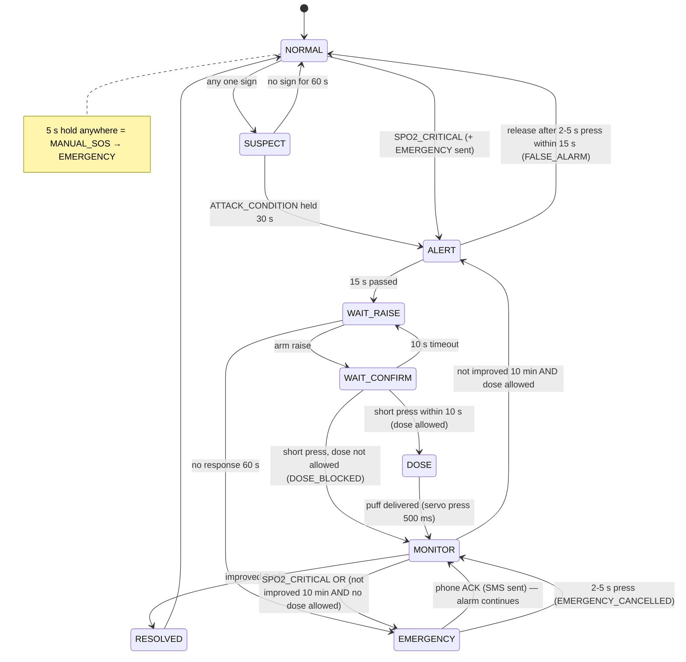

# AsthmaGuard — report material

Student prototype, not a certified medical device. The patient must still carry their normal inhaler.

## 1. Block diagram

```mermaid
flowchart LR
  subgraph Wrist["Wristband (Pico 2 W)"]
    MAX[MAX30102<br/>HR + SpO2<br/>I2C 0x57] --> C0
    IMU[MPU6050<br/>activity + arm raise<br/>I2C 0x68] --> C0
    BTN[Button<br/>GP16] --> C0
    MIC[INMP441<br/>I2S 16 kHz] --> C1
    C1["Core 1<br/>log-mel features<br/>int8 DS-CNN (TFLM)<br/>every 250 ms"] -- cough scores<br/>queue --> C0
    C0["Core 0<br/>detector + state machine (1 Hz)<br/>event log, config (LittleFS)"] --> VIB[Vibration motor<br/>GP14 via 2N2222]
    C0 --> BUZ[Buzzer<br/>GP13 via 2N2222]
    C0 --> SERVO[SG90 servo<br/>GP15, 5 V boost] --> MDI[MDI inhaler]
    C0 <--> BLE((BLE GATT))
  end
  BLE <--> APP
  subgraph Phone["Flutter app (Android)"]
    APP[Live view · history · charts<br/>doctor area (PIN) · PDF]
    APP --> SMS[SMS + GPS link<br/>to family]
    APP --> CALL[Call 123]
  end
```

## 2. State diagram (as implemented)



## 3. Wiring

| From | To | Notes |
|---|---|---|
| LiPo 3.7 V ≥ 1000 mAh | TP4056 (with protection) B+/B− | charge via USB-C on the TP4056 |
| TP4056 OUT+ | Pico VSYS (pin 39) and MT3608 IN+ | |
| MT3608 OUT (set to 5.0 V) | SG90 red | + 100–470 µF across 5 V/GND at the servo |
| Pico 3V3(OUT) (pin 36) | MAX30102 VIN, MPU6050 VCC, INMP441 VDD | |
| GP4 (pin 6) / GP5 (pin 7) | SDA / SCL of MAX30102 and MPU6050 | shared I2C0, 400 kHz |
| GP10 / GP11 / GP12 | INMP441 SCK / WS / SD | WS must be BCLK+1; INMP441 L/R → GND |
| GP13 → 1 kΩ → 2N2222 base | buzzer − (buzzer + to 3V3) | emitter to GND |
| GP14 → 1 kΩ → 2N2222 base | motor − (motor + to 3V3), 1N4148 across the motor | never drive the motor from the GPIO |
| GP15 | SG90 signal (orange) | |
| GP16 | button → GND | INPUT_PULLUP |
| all GND | common | |

## 4. Test results (simulation mode, host build of the real firmware logic)

`cd firmware && pio test -e native` runs these on the same C++ that runs on the board (`Core` = detector + state machine + event log + simulation).

| # | Scenario | Expected | Test | Result |
|---|---|---|---|---|
| 1 | Normal rest (10 min) | stays NORMAL | `s01_normal_rest` | pass |
| 2 | Jogging (HR 150, EXERCISE), also with coughs | no alert | `s02_jogging_no_alert` | pass |
| 3 | Coughing only | SUSPECT, no alert; NORMAL 60 s after | `s03_cough_only_suspect` | pass |
| 4 | Cough + HR 125 for 30 s (29 s not enough; a 1 s break restarts) | ALERT | `s04_cough_hr_30s_alert` | pass |
| 5 | Alert, long-press within 15 s (not after) | FALSE_ALARM, NORMAL | `s05_false_alarm` | pass |
| 6 | Alert → raise → press | one puff, MONITOR → RESOLVED after 3 min improved | `s06_raise_confirm_one_puff` | pass |
| 7 | Raise, no button | no puff | `s07_raise_no_button_no_puff` | pass |
| 8 | No response 60 s | EMERGENCY, stays until phone ACK | `s08_no_response_emergency` | pass |
| 9 | SpO2 91 for 20 s (invalid readings ignored) | ALERT + EMERGENCY, sent once | `s09_spo2_critical` | pass |
| 10 | Doses at the limit / interval | no more puffs, EMERGENCY if not improved | `s10_dose_limit_then_emergency` | pass |
| 11 | Phone disconnected | events kept in order until ACK | `s11_events_survive_disconnect` | pass |
| 12 | Dose limits not set | alerts work, servo never moves | `s12_no_dose_limits_servo_never_moves` | pass |
| 13 | 5 s long-press anytime | MANUAL_SOS | `s13_manual_sos_anytime` | pass |

Phase 7 (on the real wristband, end to end with the phone) still has to be run by the team; fill in the same table with real-sensor results and timings.

## 5. Cough model

See `ml/report.json` (written by the Kaggle run) for test accuracy, confusion matrix, false-cough rate on noise and the worst noise sources. On-board latency: `SELFTEST` on the serial console.

## 6. Limitations & future work

- Wrist SpO2 is less accurate than finger SpO2, so readings are only used when the wrist was still for 5 s and the signal passes the quality check.
- Only cough sounds are detected. Future: a chest sensor (contact mic / accelerometer patch) for wheezing.
- Thresholds are general adult values plus a personal baseline. A real product needs clinical validation.
- iOS cannot send SMS automatically (opens a pre-filled message instead). The demo is on Android.
- The model is trained on phone/web recordings (COUGHVID, Coswara) and general noise (ESC-50, Speech Commands); on-wrist INMP441 recordings by the team are needed to confirm the accuracy on the real device.
- Pending events live in RAM: if the battery dies they are lost (event ids are persisted, so they never repeat).
